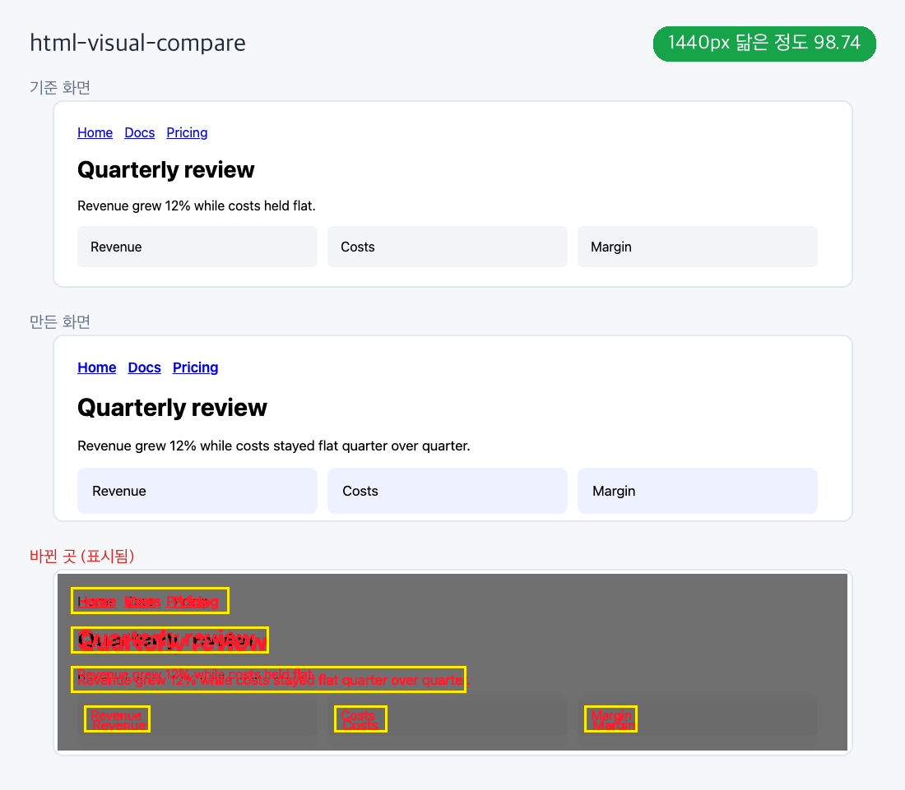

<div align="center">


# html-visual-compare

레퍼런스 페이지와 후보 페이지를 같은 뷰포트로 찍어 비교하고, 시각적 차이를 점수와 보고서로 내는 커맨드라인 도구 겸 파이썬 라이브러리.

[English](README.md) · Python 3.9+

[](https://pypi.org/project/html-visual-compare/)
[](https://github.com/elfenomenokim/html-visual-compare/actions/workflows/tests.yml)
[](LICENSE)

[설치](#설치) · [빠른-시작](#빠른-시작) · [왜-필요한가](#왜-필요한가) · [레퍼런스](#레퍼런스)

</div>

<p align="center">

</p>

**두 웹페이지가 눈으로 보기에 얼마나 똑같은지 점수로 알려 주는 도구입니다.** 기준이 되는 페이지와 내가 만든 페이지를 같은 화면 크기로 찍고, 화면 크기마다 닮은 정도(0–100)와 바뀐 곳을 표시한 이미지를 냅니다.

- **디자인 시안대로 만들었나?** 시안과 구현 화면을 비교합니다.
- **코드를 고쳤더니 화면이 바뀌었나?** 이전 버전과 새 버전을 비교합니다.
- **사이트를 따라 만들었나?** 원본 주소와 재현한 페이지를 비교합니다.

배치(요소 위치·크기)와 그림(픽셀)을 따로 채점하고, 세 장을 나란히 놓은 HTML 보고서와 바뀐 영역 목록(후보 페이지의 CSS 선택자 포함)을 씁니다. 위 그림은 저장소의 `docs/demo/` 두 페이지를 실제로 비교한 결과입니다. 1440, 768, 390px에서 98.74, 97.75, 95.99가 나왔습니다.

## 설치

```sh
pipx install html-visual-compare
uv tool install html-visual-compare
pip install html-visual-compare
python3 -m playwright install chromium
```

Python 3.9 이상, `numpy`, `Pillow`, `playwright`가 필요합니다. 브라우저 설치를 따로 둔 이유는 Playwright가 자기 Chromium을 내려받기 때문입니다. 이미 있는 브라우저를 쓸 때는 `--browser`를 주십시오. macOS arm64 · Python 3.12에서 확인했습니다.

## 빠른 시작

로컬 초안을 레퍼런스 페이지와 비교합니다.

```sh
html-visual-compare \
  --reference https://example.com/pricing \
  --candidate-html ./build/pricing.html \
  --output-dir /tmp/compare
```

```json
{
  "output_dir": "/tmp/compare",
  "report": "/tmp/compare/report.html",
  "results": [
    {"width": 1440, "layout_similarity": 99.82, "image_similarity": 97.66, "likeness": 98.74},
    {"width": 768,  "layout_similarity": 99.67, "image_similarity": 95.83, "likeness": 97.75},
    {"width": 390,  "layout_similarity": 99.36, "image_similarity": 92.62, "likeness": 95.99}
  ]
}
```

이미 저장해 둔 스크린샷과 비교하려면 폭마다 PNG 하나씩 두고 씁니다.

```sh
html-visual-compare \
  --reference-images ./shots \
  --candidate https://staging.example.com \
  --output-dir /tmp/compare --widths 1440,768
```

파이썬에서 부를 때:

```python
from html_visual_compare import compare

payload = compare(
    reference="https://example.com/pricing",
    candidate_html="./build/pricing.html",
    output_dir="/tmp/compare",
    widths=(1440, 768),
    title="Pricing, before and after",
)
print(payload["results"])
```

## 왜 필요한가

페이지 둘을 비교하는 뻔한 방법은 픽셀 차이입니다. 그 방법은 히어로의 글꼴이 바뀐 것을 "40% 다름"으로 보고하면서, 왼쪽 칸에 있던 카드가 오른쪽 칸으로 옮겨 간 것은 놓칩니다. 옮겨진 블록과 다시 칠한 블록은 픽셀 개수에는 똑같이 보이기 때문입니다. 이 도구는 두 질문을 나눕니다.

- **배치**는 16×16 격자의 평균 셀 색을 봅니다. 같은 구성이 같은 자리에 있는지를 답하고, 글자 모양에는 조용합니다.
- **이미지**는 전체 페이지에 걸쳐 8×8 SSIM 창을 국소적으로 계산합니다. 세부가 맞는지를 답하고, 커다란 빈 영역 하나에 휩쓸리지 않습니다.

`likeness`는 둘의 같은 무게 평균입니다. 그래서 어느 한쪽이 다른 쪽을 가릴 수 없습니다. 바뀐 픽셀 마스크는 영역으로 합쳐지고, 영역마다 중심 아래에 있는 후보 노드의 선택자와 텍스트가 붙습니다. 리뷰하는 사람이 움직인 것을 찾는 데 필요한 정보가 그것입니다.

결과는 글이 아니라 파일입니다. `report.html` 하나에 폭마다 레퍼런스, 후보, 차이 이미지가 들어 있습니다.

| | html-visual-compare | Playwright `toHaveScreenshot` | BackstopJS | Percy |
|---|---|---|---|---|
| 비교 대상 | 아무 두 페이지·이미지 | 저장해 둔 기준 스크린샷 | 시나리오 설정의 기준 스크린샷 | 클라우드에 올린 기준 빌드 |
| 결과 | 폭마다 점수 2개 + 바뀐 영역의 선택자 | 통과/실패 | 통과/실패 + 보고서 | 리뷰 화면 |
| 필요한 것 | Python 하나 | 테스트 러너 안에서 | Node 설정 파일 | 유료 SaaS 계정 |
| 잘하는 것 | 처음 보는 두 페이지를 바로 비교 | 회귀 테스트를 CI에서 막기 | 여러 화면 시나리오 관리 | 팀 리뷰·승인 흐름 |

이미 기준 스크린샷과 테스트가 있다면 Playwright나 BackstopJS가 맞습니다. 기준을 따로 만들지 않고 "이 두 페이지가 얼마나 같은가"를 바로 묻고 싶을 때 이 도구를 씁니다.

## 레퍼런스

### 명령

| 옵션 | 의미 |
| --- | --- |
| `--reference URL` | 레퍼런스 페이지. `--reference-images`와 함께 쓸 수 없습니다. |
| `--reference-images DIR` | `<width>.png` 파일들, 또는 폭과 경로를 담은 JSON. |
| `--candidate URL` | 후보 페이지. |
| `--candidate-html FILE` | 후보 로컬 HTML 파일. |
| `--output-dir DIR` | 캡처, `results.json`, `report.html`을 쓸 디렉터리. 필수. |
| `--widths LIST` | 쉼표로 구분한 뷰포트 폭. 기본 `1440,768,390`, 각 폭은 120 이상. |
| `--viewport-height PX` | 뷰포트 높이. 기본 1000. |
| `--keep-height LIST` | 캡처를 위에서부터 N픽셀까지만 남깁니다. 값을 하나 주면 모든 폭에, 여러 개 주면 `--widths` 순서대로 폭마다 적용합니다. 기본은 전체 페이지. |
| `--diff-threshold N` | 바뀐 픽셀로 볼 채널 평균 차이, 0–255. 기본 28. |
| `--browser PATH` | 브라우저 실행 파일. 없으면 `VISUAL_COMPARE_BROWSER`, PATH, macOS 기본 위치, Playwright 순으로 찾습니다. |
| `--title TEXT` | 보고서 제목. 기본 `Visual comparison`. |
| `--timeout-ms N` | 이동과 캡처 제한 시간. 기본 45000. |

### 라이브러리

```python
compare(*, reference=None, reference_images=None, candidate=None, candidate_html=None,
        output_dir, widths=(1440, 768, 390), browser=None, viewport_height=1000,
        keep_heights=None, diff_threshold=28, title="Visual comparison", timeout_ms=45000) -> dict
```

명령이 출력하는 것과 같은 페이로드를 돌려줍니다. `output_dir`, `report`, 폭별 `results`가 들어 있습니다.

함께 내보내는 것: 감지된 브라우저를 알려 주는 `chrome_path()`, URL과 경로를 모두 받는 `page_url(value)`, `--widths` 문법을 읽는 `parse_widths(text)`, `--keep-height`를 읽는 `parse_keep_heights(text)`.

### 출력

| 파일 | 내용 |
| --- | --- |
| `results.json` | `schema`, `widths`, 사용한 `keep_heights`, 폭별 점수, `layout_unavailable`, 이미지 이름, 영역 목록, 후보 DOM 노드. |
| `report.html` | 폭마다 세 이미지, 백분율 점수, 순위가 매겨진 영역. |
| `candidate-<w>.png`, `reference-<w>.png`, `diff-<w>.png` | 전체 페이지 캡처와 표시된 차이. |

### 단위 하나

**`likeness`는 `layout_similarity`와 `image_similarity`의 평균이고, 셋 다 백분율입니다.** 두 신호를 점수 옆에 함께 적으므로, 점수 하나가 어느 신호가 움직였는지를 감추지 않습니다. 저장된 이미지를 레퍼런스로 주면 DOM이 없으므로 `layout_similarity`는 사유가 담긴 `layout_unavailable`과 함께 `null`이 되고, `likeness`는 이미지 점수만 씁니다.

## 숫자

2026-11-19, macOS arm64(M5 Pro), Python 3.12.8에서 쟀습니다. 값은 `docs/bench/fixture.json`에 있습니다.

| 픽스처 쌍 | 1440 | 768 | 390 |
| --- | --- | --- | --- |
| `docs/demo/a.html` 대 `b.html`, 배치 | 99.82 | 99.67 | 99.36 |
| 같은 쌍, 이미지 | 97.66 | 95.83 | 92.62 |
| 같은 쌍, 유사도 | 98.74 | 97.75 | 95.99 |

`a.html`을 자기 자신과 비교하면 세 폭 모두 100.00이 나왔습니다. 도구가 흐리면 안 되는 바닥 사례입니다.

## 한계

- **전체 페이지 캡처만 합니다.** 상호작용, 호버, 스크롤 뒤에 바뀌는 상태는 다루지 않습니다. 첫 단계만 보이는 차트는 이 도구가 볼 수 있는 결함이 아닙니다.
- **글꼴과 렌더링은 기기마다 다릅니다.** 같은 HTML이라도 글꼴 스택이 다르면 픽셀이 다릅니다. 한 호스트에서 비교하거나, 이미지 점수의 잡음을 감수하십시오.
- **줄바꿈 차이를 봐주지 않습니다.** 텍스트 재배치는 실제 픽셀 차이입니다. 배치 점수가 그 영향을 줄이지만 없애지는 않습니다.
- **비교는 테스트 단언이 아닙니다.** 점수 기준의 통과/실패 플래그나 종료 코드가 없습니다. 페이지마다 허용 오차를 알게 되면 JSON을 자체 게이트에 연결하십시오.
- **Linux와 Windows에서는 실행해 보지 않았습니다.** 브라우저 탐색이 이름으로 그 플랫폼을 덮지만 실행으로 확인한 적은 없습니다.
- **선행 사례.** 점수 구성 방식은 [storytold/craft-anything](https://github.com/storytold/craft-anything) (MIT/Apache-2.0)의 측정형 웹사이트 점검 형태를 따랐습니다. 구현은 독립적이고 업스트림 소스 코드를 복사하지 않았습니다. 전체 시각 회귀 도구가 필요하면 [BackstopJS](https://github.com/garris/BackstopJS)를 보십시오.

## 자주 묻는 질문

**왜 기본이 폭 세 개입니까?** 1440, 768, 390이 데스크톱, 태블릿, 휴대폰을 덮습니다. 다른 조합은 `--widths`로 주십시오. 레퍼런스 이미지를 폭으로 맞추므로, 맞지 않으면 어떤 파일이 없는지 이름을 대고 실패합니다.

**눈에 바뀐 것이 없는데 왜 100이 안 됩니까?** 같은 호스트에서 같은 페이지를 두 번 찍어도 안티에일리어싱과 스크롤바 렌더링이 조금 다를 수 있습니다. 페이지를 자기 자신과 비교하면 100이 나오고, 따로 찍은 두 캡처는 보통 99.x입니다.

**URL 둘을 비교할 수 있습니까?** 됩니다. `--reference URL --candidate URL`로 비교합니다. 로컬 파일 둘은 `--candidate-html`과 레퍼런스 이미지 묶음으로 비교합니다.

## 기여

버그 보고와 패치를 환영합니다. 동작 변경에 필요한 픽스처 쌍은 [CONTRIBUTING.md](CONTRIBUTING.md)에 있습니다.

## 라이선스

MIT, [LICENSE](LICENSE).
