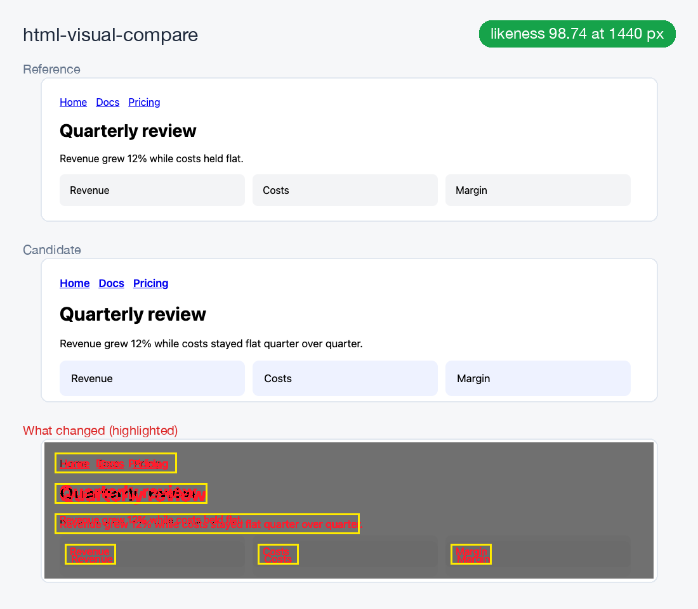

<div align="center">


# html-visual-compare

A command-line tool and Python library that screenshot a reference and a candidate page, then score and report the visual difference.

[한국어](README.ko.md) · Python 3.9+

[](https://pypi.org/project/html-visual-compare/)
[](https://github.com/elfenomenokim/html-visual-compare/actions/workflows/tests.yml)
[](LICENSE)

[Install](#install) · [Quick start](#quick-start) · [Why](#why) · [Reference](#reference)

</div>

<p align="center">

</p>

**A tool that tells you, as a score, how alike two web pages look.** It captures a reference page and your page at the same viewport and reports a likeness (0–100) per width, plus an image with every change marked.

- **Did we build what the design shows?** Compare the mock-up with the implementation.
- **Did a code change move the page?** Compare the previous version with the new one.
- **Did the rebuild match the original site?** Compare the original URL with the reconstruction.

Layout (element positions and sizes) and image (pixels) are scored separately, and an HTML report puts the three captures side by side with a list of changed regions, each tagged with the candidate's CSS selector. The picture above is a real run on the two pages in `docs/demo/`: 98.74, 97.75 and 95.99 at 1440, 768 and 390 px.

## Install

```sh
pipx install html-visual-compare
uv tool install html-visual-compare
pip install html-visual-compare
python3 -m playwright install chromium
```

Python 3.9+, plus `numpy`, `Pillow` and `playwright`. The browser step is separate because Playwright downloads its own Chromium; pass `--browser` to use one you already have. Verified on macOS arm64 with Python 3.12.

## Quick start

Compare a local draft against a reference page:

```sh
html-visual-compare \
  --reference https://example.com/pricing \
  --candidate-html ./build/pricing.html \
  --output-dir /tmp/compare
```

```json
{
  "output_dir": "/tmp/compare",
  "report": "/tmp/compare/report.html",
  "results": [
    {"width": 1440, "layout_similarity": 99.82, "image_similarity": 97.66, "likeness": 98.74},
    {"width": 768,  "layout_similarity": 99.67, "image_similarity": 95.83, "likeness": 97.75},
    {"width": 390,  "layout_similarity": 99.36, "image_similarity": 92.62, "likeness": 95.99}
  ]
}
```

Compare against screenshots you already saved, one PNG per width:

```sh
html-visual-compare \
  --reference-images ./shots \
  --candidate https://staging.example.com \
  --output-dir /tmp/compare --widths 1440,768
```

From Python:

```python
from html_visual_compare import compare

payload = compare(
    reference="https://example.com/pricing",
    candidate_html="./build/pricing.html",
    output_dir="/tmp/compare",
    widths=(1440, 768),
    title="Pricing, before and after",
)
print(payload["results"])
```

## Why

The obvious way to compare two pages is a pixel diff. That reports a font change in the hero as "40% different" while missing a card that moved from the left column to the right, because a moved block and a repainted block look the same to a per-pixel count. This tool separates the two questions:

- **Layout** samples a 16×16 grid of average cell colours. It answers "is the same composition in the same places" and stays quiet about glyph shapes.
- **Image** computes local 8×8 SSIM windows over the full page. It answers "do the details match" and is not swamped by one large empty region.

`likeness` is their equal-weight mean, so neither can hide the other. The changed-pixel mask is then merged into regions and each region gets the selector and label of the candidate node under its centre, which is what a reviewer needs to find the thing that moved.

Prose is not the only output: the report is a single self-contained `report.html` with reference, candidate and diff for every width.

| | html-visual-compare | Playwright `toHaveScreenshot` | BackstopJS | Percy |
|---|---|---|---|---|
| Compares | any two pages or images | a stored baseline screenshot | baselines from a scenario config | a baseline build in the cloud |
| Result | two scores per width + selectors of changed regions | pass / fail | pass / fail + report | a review UI |
| Needs | Python | its test runner | a Node config | a paid SaaS account |
| Best at | comparing two pages you have never baselined | blocking regressions in CI | managing many screen scenarios | team review and approval |

If you already keep baselines and tests, Playwright or BackstopJS fits better. Use this tool when you want to ask "how alike are these two pages?" without building a baseline first.

## Reference

### Command

| Option | Meaning |
| --- | --- |
| `--reference URL` | Reference page. Mutually exclusive with `--reference-images`. |
| `--reference-images DIR` | Directory of `<width>.png` files, or a JSON map of width to image path. |
| `--candidate URL` | Candidate page. |
| `--candidate-html FILE` | Candidate local HTML file. |
| `--output-dir DIR` | Where captures, `results.json` and `report.html` are written. Required. |
| `--widths LIST` | Comma-separated viewport widths. Default `1440,768,390`; each must be at least 120. |
| `--viewport-height PX` | Viewport height. Default 1000. |
| `--keep-height LIST` | Crop every capture to its top N pixels: one value for all widths, or one per width in `--widths` order. Default: full page. |
| `--diff-threshold N` | Per-pixel mean channel difference counted as changed, 0–255. Default 28. |
| `--browser PATH` | Browser executable. Falls back to `VISUAL_COMPARE_BROWSER`, then PATH, then the macOS locations, then Playwright's download. |
| `--title TEXT` | Report heading. Default `Visual comparison`. |
| `--timeout-ms N` | Navigation and screenshot timeout. Default 45000. |

### Library

```python
compare(*, reference=None, reference_images=None, candidate=None, candidate_html=None,
        output_dir, widths=(1440, 768, 390), browser=None, viewport_height=1000,
        keep_heights=None, diff_threshold=28, title="Visual comparison", timeout_ms=45000) -> dict
```

Returns the same payload the command prints, including `output_dir`, `report` and per-width `results`.

Also exported: `chrome_path()` for the detected browser, `page_url(value)` for URL-or-path input, `parse_widths(text)` for the `--widths` syntax and `parse_keep_heights(text)` for `--keep-height`.

### Output

| File | Contents |
| --- | --- |
| `results.json` | `schema`, `widths`, the `keep_heights` used, and per-width scores, `layout_unavailable`, image names, region list and candidate DOM nodes. |
| `report.html` | The visual report: three images per width, scores as percentages, ranked regions. |
| `candidate-<w>.png`, `reference-<w>.png`, `diff-<w>.png` | Full-page captures and the marked diff. |

### One unit

**`likeness` is the mean of `layout_similarity` and `image_similarity`, each a percentage.** Both halves are printed next to it, so a score never hides which signal moved. A stored-image reference has no DOM: its `layout_similarity` is `null` with a `layout_unavailable` reason, and `likeness` is the image score alone.

## Numbers

Measured on 2026-11-19 on macOS arm64 (M5 Pro), Python 3.12.8, from `docs/bench/fixture.json`.

| Fixture pair | 1440 | 768 | 390 |
| --- | --- | --- | --- |
| `docs/demo/a.html` vs `b.html`, layout | 99.82 | 99.67 | 99.36 |
| same pair, image | 97.66 | 95.83 | 92.62 |
| same pair, likeness | 98.74 | 97.75 | 95.99 |

`a.html` against itself scored 100.00 at all three widths, which is the floor case the tool must not blur.

## Limits

- **Full-page captures only.** Interaction, hover and below-fold state-changing behaviour are not exercised. A chart that shows its first step is not a defect this tool can see.
- **Fonts and rendering differ per machine.** Two machines with different font stacks produce different pixels for the same HTML. Compare on one host, or accept the noise in the image score.
- **No perceptual tolerance for text reflow.** Wrapping differences are real pixel differences; the layout score dampens them but does not ignore them.
- **The comparison is not a test assertion.** There is no threshold flag and no pass/fail exit code for scores; wire the JSON into your own gate when you know the tolerance for your pages.
- **Linux and Windows have not been exercised.** Browser discovery covers them by name, but no run has confirmed it.
- **Prior art.** The score split follows the measured website-check shape in [storytold/craft-anything](https://github.com/storytold/craft-anything) (MIT/Apache-2.0). This implementation is independent; no upstream source code is copied. See [BackstopJS](https://github.com/garris/BackstopJS) for full visual-regression suites.

## FAQ

**Why three widths by default?** 1440, 768 and 390 cover a desktop, a tablet and a phone. Pass `--widths` for your own set; the reference images are matched by width, so a mismatch is a named error.

**Why does a page with no visible change score below 100?** Anti-aliasing and scrollbar rendering can differ between two runs of the same page on the same host. A page compared against itself scores 100; two separately captured pages usually score 99.x.

**Can I compare two URLs?** Yes: `--reference URL --candidate URL`. Two local files work through `--candidate-html` plus a reference image set.

## Contributing

Bug reports and patches are welcome. See [CONTRIBUTING.md](CONTRIBUTING.md) for the fixture pair each behaviour change needs.

## Licence

MIT, in [LICENSE](LICENSE).
